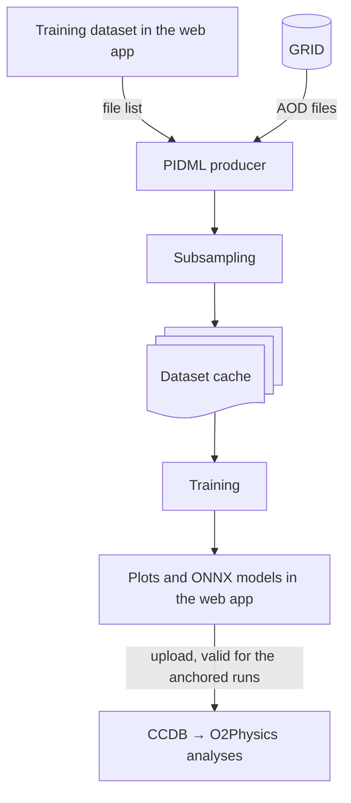

# Getting started

AliceTraINT trains machine-learning models for particle identification (PIDML) in ALICE. You choose simulated AOD files, queue a training task, and a training machine prepares the data, trains the models and sends back plots and ONNX files that you can upload to CCDB.

## Access

You need a CERN account that is a member of the `wut-alice-pidml` e-group. Click **Login with CERN SSO** on the landing page; the e-group membership is checked there.

These docs are readable without logging in.

## How it works

A training run passes through four places: the GRID, where the AOD files are; the web app, where you choose them and review results; a training machine, which does the work; and CCDB, from which O2Physics analyses read the trained models. The steps from the PIDML producer to training run in the training module on the training machine.

A training dataset is a fixed list of simulated AOD files. A training task trains one configuration on one dataset; it waits in a queue until a registered training machine takes it. The training module on that machine prepares the dataset, trains one model per particle and uploads the results. You then review the plots and upload the models to CCDB.

## Your first run

This example trains models with the default settings on a small dataset: six files of the LHC26e9 production, two from each of three runs. It follows the task `lhc26e9_task0` on the dataset `26e9_test`.

1. Open **Datasets** and click **Create Training Dataset**. In the directory list, open `/alice/sim/2026/LHC26e9/`. Under **Choose random subset**, set **Run count** to 3 and **Files per run** to 2, keep the minimum file size and click **Select Random Subset** ([Training datasets](/docs/training-datasets)).

   

   The six selected files appear under **Selected files**. Enter the name `26e9_test`.

   

   The app follows the colour mode of your system; the picture shows both.

2. Click **Submit**. After the lookup in MonALISA and CCDB, the dataset appears in the list.

   

3. Open **Tasks** and click **Create Training Task**. Enter the name `lhc26e9_task0`, choose `26e9_test`, tick **Use subsample** and keep the rest of the default configuration. Click **Submit**; the task is Queued ([Training tasks](/docs/training-tasks)).

   

4. Wait until a training machine takes the task. Its status changes to Training, then Benchmarking and finally Completed ([Task statuses](/docs/training-tasks#sec-task-statuses)).

   

5. Open the task. The page shows the plots, the six ONNX files and the logs of each step ([Results and CCDB upload](/docs/results-and-ccdb-upload)).

   

The next step of a real run is uploading the models to CCDB, which this example leaves out.

## Where to go next

- Machine owners: [Setting up a training machine](/docs/setting-up-a-training-machine).
- Developers: [Architecture](/docs/architecture) and [Local development](/docs/local-development).
- Operators: [Configuration](/docs/configuration).

The code is open source: the [web app](https://github.com/mytkom/AliceTraINT) and the [training module](https://github.com/mytkom/AliceTraINT_pidml_training_module).
