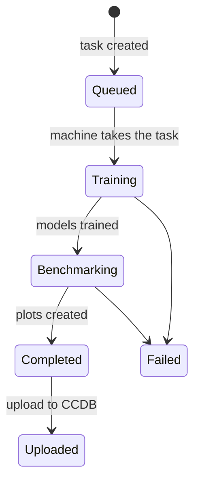

# Training tasks

A training task trains one configuration on one training dataset. It waits in a queue until a training machine takes it, and the machine sends back logs, ONNX models and plots.

## Browsing training tasks

Open **Tasks** in the navigation. On narrow screens, open the menu first.
Select a task name to view its details. The **Status** column shows the current
state. On narrow screens, scroll the table horizontally to see all columns.

The theme follows your device until you use the **Dark mode** button. The app
remembers your choice in the current browser.

## Creating a task

Open **Tasks** and click **Create Training Task**. Enter a **Task name**, choose a **Training dataset** and adjust the configuration below, then click **Submit**. The new task is Queued.

Task names are unique within a dataset, so the same name can be used again on another dataset. You can choose only your own datasets.

## Configuration

Select a group heading to expand or collapse its settings. Data starts open, and you can keep several groups open at once. Collapsing a group keeps its current values. If a field in a collapsed group needs a correction, submitting the form opens that group and takes you to the field.

Every setting has a short description on the form, and the defaults are a reasonable start.

| Group | What it sets |
|---|---|
| Events | Whether the dataset is subsampled to a fixed number of events after the producer, and that number |
| Data | How the data is split into training and test sets, which input columns are used and how outliers are filtered |
| Model | The architecture and its settings |
| Training | Optimizer, learning-rate schedule, batch size, number of epochs, early stopping and class balancing |
| Validation | How often the model is validated during training |
| General | The random seed |

Keep **Use subsample** ticked, with the default **Count** of 400000 or another value. The training module currently needs a count, and a task without one fails as soon as a training machine takes it.

**Architecture** in the Model group selects one of seven models. The form then shows only the settings of that model.

Only Attention, the default, is currently supported. The other architectures are on the form but have not been verified with the current training module, so a task that uses one of them may fail or give wrong results.

| Architecture | Kind | Support | Description |
|---|---|---|---|
| Attention | Neural network | Supported | Embeds the inputs, then combines them with multi-head attention blocks and attention pooling |
| MLP | Neural network | Not verified | Fully connected layers; missing detector values are filled in as set by **Missing data strategy** |
| Ensemble | Neural network | Not verified | Fully connected layers, with the same settings as MLP except the missing-data strategy |
| Attention DANN | Neural network | Not verified | The attention network with a domain classifier trained adversarially (DANN) |
| Attention CDAN | Neural network | Not verified | The attention network with a conditional domain-adversarial classifier (CDAN) |
| Boosting LightGBM | Gradient boosting | Not verified | LightGBM trees; their hyperparameters are searched with Optuna in the given ranges |
| Boosting XGBoost | Gradient boosting | Not verified | XGBoost trees; their hyperparameters are searched with Optuna in the given ranges |

## Reusing a configuration

On a task's page, **Reuse in new task** opens the form with that task's dataset and configuration filled in, and its name followed by "(copy)". **Copy JSON** copies the configuration to the clipboard.

To run a failed task again, use **Reuse in new task**. Tasks cannot be edited or removed.

## How tasks are assigned

All tasks wait in one shared queue. A training machine that asks for work gets the oldest Queued task, whoever created it, so any registered machine may train your task. Each machine asks again every few seconds while it is idle and takes one task at a time.

## Task statuses

| Status | Meaning |
|---|---|
| Queued | Waiting for a training machine |
| Training | A machine has taken the task. It downloads and prepares the dataset, then trains the models |
| Benchmarking | The models are trained and their ONNX files uploaded; the machine creates the plots |
| Completed | All results are in, and the models can be uploaded to CCDB |
| Uploaded | The models were uploaded to CCDB |
| Failed | A step failed on the training machine |

A task moves forward through these statuses, and only the training machine or a CCDB upload changes them. Reuploading an Uploaded task keeps it Uploaded.

## Troubleshooting

| Problem | Solution |
|---|---|
| The task is Failed | Open the task and read its logs, starting with the error log of the last step ([Logs](/docs/results-and-ccdb-upload#sec-logs)) |
| The task stays Queued or Training for a long time | Check on **Machines** that a training machine is active, and ask its owner |
