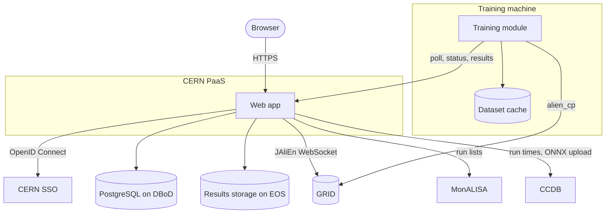
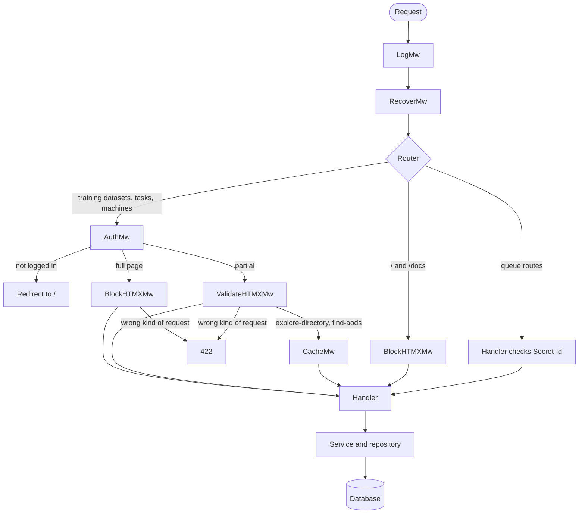

# Architecture

AliceTraINT has two programs: the web app, which users log in to, and the training module, which runs on training machines and does the training. Everything else is an external service at CERN that one of the two calls.

## The parts

The web app is the only part that users and training modules talk to. Training modules always start the conversation: they poll the web app for work, so a training machine needs outbound network access only and the web app never connects to it.

The web app runs as one container on CERN PaaS (OpenShift). It keeps its data in a PostgreSQL database on CERN DB-on-Demand and stores the files that training tasks upload (logs, plots, ONNX models) in a directory on EOS.

| Service | Used for | Protocol |
|---|---|---|
| CERN SSO | Logging users in | OpenID Connect over HTTPS |
| JAliEn | Browsing GRID directories and finding AOD files for a training dataset | WebSocket over TLS, authenticated with the GRID certificate |
| MonALISA | Run lists of productions, anchored productions and period descriptions | HTTPS, authenticated with the GRID certificate |
| CCDB | Start and end times of runs, and uploading ONNX models | HTTPS, authenticated with the GRID certificate |
| GRID storage | Downloading AOD files (training module only) | `alien_cp` |

The web app uses its GRID certificate for JAliEn, MonALISA and CCDB, and does not start without one.

## Inside the web app

The web app is a Go program that renders HTML on the server. Pages are Go templates, and HTMX (loaded from unpkg) replaces parts of a page, such as a list or a search result, without a full reload.

| Part | Location | Role |
|---|---|---|
| Entry point | `cmd/AliceTraINT/main.go` | Loads the configuration, migrates the database and starts the HTTP server |
| Router | `internal/router.go` | Creates the services and registers every route |
| Middleware | `internal/middleware/` | Logging, panic recovery, login check, HTMX checks and caching |
| Handlers | `internal/handler/` | Read the request, call a service and render a template or JSON |
| Services | `internal/service/` | Business rules: validation, the task queue, uploads to CCDB, docs rendering |
| Repositories | `internal/db/repository/` | Database queries through GORM |
| Models | `internal/db/models/` | Database tables; see [Data model](/docs/data-model) |
| Clients | `internal/jalien/`, `internal/monalisa/`, `internal/ccdb/` | Calls to external services |
| Login | `internal/auth/` | CERN SSO and sessions |
| Templates | `web/templates/` | HTML pages and partials, parsed once at startup |
| Static files | `static/` | CSS, JavaScript and images, served at `/static/` |

Each group of routes (training datasets, training tasks, training machines, the machine queue, docs) has its own handler file with an `Init…Routes` function that registers its routes.

## A request from browser to database

Every request passes through `LogMw` and `RecoverMw`, which log the request and turn a panic into a 500 response. The router then chooses the middleware for the route.

`AuthMw` checks the session and puts the logged-in user into the request context. Full pages, such as `/training-tasks`, refuse HTMX requests, and partials, such as `/training-tasks/list`, accept only HTMX requests. Either check answers a request of the wrong kind with status 422.

The routes that training modules call (`/training-machines/{id}/training-task` and the `/training-tasks/{id}/…` status and result routes) have no middleware of their own. Their handler checks the machine's secret key from the `Secret-Id` header and answers 401 if it does not match.

Static files under `/static/` and `/docs/static/` are served without a login. Stored result files under `/data/` need a login, and a request without one gets 401 instead of a redirect.

## Login and sessions

`/login` sends the user to CERN SSO, and CERN SSO sends them back to `/callback`. The web app checks the ID token, creates a user on the first login (matched by the CERN person ID) and stores the user's ID in a session. The session cookie is `gosessionid`.

Sessions are kept in the web app's memory, so a restart or a new deployment logs everyone out. Membership of the `wut-alice-pidml` e-group is checked by the CERN SSO application, not by the web app.

The landing page and these docs are public. Every page about training datasets, tasks or machines redirects to the landing page when nobody is logged in.

## Caching

Directory listings and AOD searches in JAliEn are slow, so the web app keeps their results in memory for `ALICETRAINT_JALIEN_CACHE_MINUTES` minutes (60 by default). The cache holds the rendered responses of `explore-directory` and `find-aods`, keyed by URL, and the AOD file lists used when selecting files across runs.

The MonALISA run list is fetched on first use and kept in memory until the web app restarts. Neither cache is shared, which is fine because production runs one instance of the web app.

## Further reading

The [bachelor's thesis](https://repository.cern/records/2vke6-ss539) that introduced AliceTraINT describes the design of its first version. Several parts have changed since then; where the thesis and these docs disagree, the docs describe the current code.
