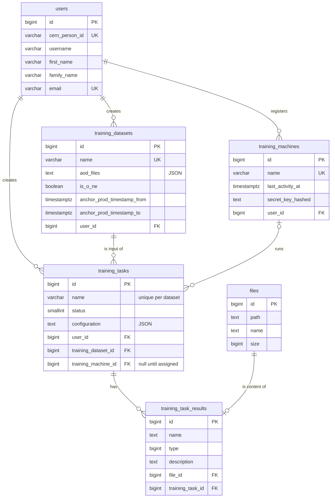

# Data model

The web app stores its data in six PostgreSQL tables, defined as GORM models in `internal/db/models/`. The web app creates and updates the tables itself when it starts.

## Tables

Every table also has the columns `created_at`, `updated_at` and `deleted_at`, which GORM adds and which the diagram leaves out. The types are the PostgreSQL column types that GORM creates. A user owns training datasets, training tasks and training machines; a training task belongs to one training dataset and has many results, and each result points to one stored file.

`users` are created on the first login through CERN SSO and matched by `cern_person_id`. The other columns come from the SSO token and are not updated on later logins.

`training_datasets` have a name that is unique across all users. `is_o_ne` is true when the MonALISA description of one of the dataset's periods mentions O-O or Ne-Ne. The two `anchor_prod_timestamp_…` columns hold the time range of the anchored production's runs, looked up in MonALISA and CCDB when the dataset is created; they become the validity period of ONNX models uploaded to CCDB.

`training_tasks` have a name that is unique within their dataset. `status` is a number from 0 to 5; the statuses and their order are described on the Training tasks page. A new task is Queued and has no machine. When a training module asks for work, the oldest queued task is assigned to its machine by setting `training_machine_id`.

`training_machines` store only an Argon2 hash of the secret key, so the key is shown once, when the machine is registered. `last_activity_at` is updated on every request the machine makes.

`training_task_results` are the files a training task uploads. `type` is 0 for a log, 1 for an image and 2 for an ONNX model.

`files` describe a stored file. `name` is the name the training module uploaded it with. `path` is its URL under `/data/`, for example `/data/2026-11-23/upload-kaon-1234567890.onnx`, and maps to the same relative path in the web app's data directory.

## JSON columns

`training_datasets.aod_files` is the list of AOD files in the dataset. Each entry has the fields `Name`, `Path` (the GRID path), `Size` (in bytes), `LHCPeriod`, `RunNumber` and `AODNumber`. The list is written when the dataset is created and never changed.

`training_tasks.configuration` is the training configuration as submitted from the task form, stored as a JSON object. Its fields come from `web/nn_architectures/proposed.json`, and the training module reads it unchanged.

Both are `text` columns holding JSON, which GORM encodes and decodes, so PostgreSQL neither checks nor indexes their content.

## Removal

Users can remove their own training datasets and training machines. Removal is a soft delete: GORM sets `deleted_at`, and normal queries skip the row, which stays in the table.

The unique indexes include removed rows, so the name of a removed dataset or machine stays taken. Training tasks keep showing their dataset after it is removed, because the task queries load datasets including removed ones.

## Migrations

The web app migrates the database on every start, with GORM's `AutoMigrate` in `internal/db/migrate/migrate.go`. AutoMigrate creates missing tables, columns and indexes. It does not drop or rename columns and does not change data, so a renamed field leaves the old column behind and needs a manual SQL step.

There are no migration files and no separate migration tool.
