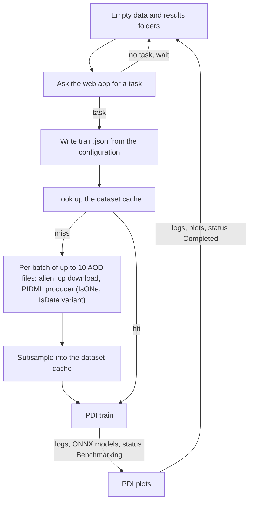

# Training module

The training module is the Go program that runs on every training machine. It asks the web app for work, prepares the dataset of the task it gets, trains and evaluates the models with the PIDML training code, and uploads the results. Its code is in the [training module repository](https://github.com/mytkom/AliceTraINT_pidml_training_module).

## The main loop

The module runs one task at a time in an endless loop, started by `cmd/AliceTraINT_pidml_training_module/main.go`. Before every request for work it empties its data and results folders, so nothing from the previous task is left except the dataset cache.

The module talks to the web app only through the three requests described on [Machine API](/docs/machine-api), and only the module starts them.

## Building a dataset

`internal/scripts/dataset_runner.go` prepares the dataset. It splits the task's AOD files into batches of at most 10 and, for each batch:

1. downloads the files with `scripts/download-multiple-grid-data.sh`, which calls `alien_cp` in the `xjalienfs` environment;
2. runs the PIDML producer with `scripts/run-pidml-mc-producer.sh`, a chain of O2Physics workflows that ends in [`o2-analysis-pid-ml-producer`](https://github.com/AliceO2Group/O2Physics/blob/master/Tools/PIDML/pidMlProducer.cxx). `IsONe` selects the oxygen-oxygen and neon-neon configuration, and `IsData` the configuration for experimental data;
3. keeps the producer's ROOT output; the downloaded files are deleted before the next batch.

After the last batch, `scripts/subsample.sh` merges the batch outputs and subsamples them to `SubsampleEventCount` events. The runner refuses a task with a count of 0 before it downloads anything.

## Dataset cache

The subsampled ROOT file is stored in `ALICETRAINT_DATASET_CACHE_DIR_PATH` as `<checksum>.root`, with `<checksum>.meta.json` next to it. The checksum is a SHA-256 of the sorted AOD file paths, `IsONe`, `IsData` and `SubsampleEventCount`. When the file already exists, the module skips the whole preparation.

In both cases the module writes the path of the cached file into `train.json`, under `sim_dataset_paths` or `exp_dataset_paths`, before training starts.

## Training and plots

Training and evaluation run in the PIDML training code, the `pdi` submodule, through `scripts/pdi_scripts.py` in the module's Python environment:

| Command | What it does | Results uploaded |
|---|---|---|
| `pdi_scripts.py train` | Trains one model per particle with the configuration in `train.json` | One ONNX file per particle, and CSV metrics |
| `pdi_scripts.py plots` | Computes SHAP values and performance plots for each particle's model | PNG plots |

## Results and errors

After every step, the module uploads that step's standard output and error logs, then the step's results. It sets the status to Benchmarking after training and to Completed after the plots; the web app has already set Training when it handed out the task.

When a step fails, the module uploads its logs and sets the status to Failed, then empties its folders and asks for the next task. The module itself stops when a request for work fails, for example because the web app is unreachable or rejects the secret key, or when setting Failed fails.

## Working on the module

The [module's README](https://github.com/mytkom/AliceTraINT_pidml_training_module#readme) describes how to build and run it locally, the mock command and mock server for testing without a real web app, and the layout of its code. Machine setup for production is on [Setting up a training machine](/docs/setting-up-a-training-machine).
