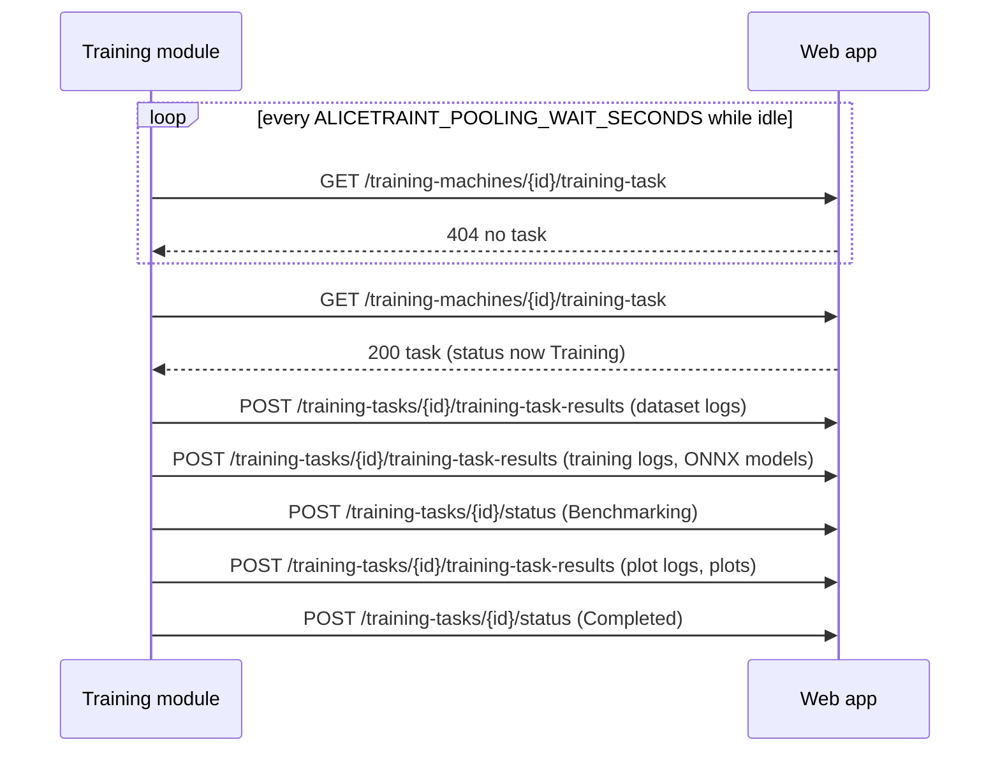

# Machine API

Training modules talk to the web app through three HTTP requests: get a task, update its status and upload a result. The handlers are in `internal/handler/queue_handler.go` of the web app, and the client is in `internal/client/` of the training module.

## Authentication

Every request carries the machine's secret key in the `Secret-Id` header. The web app checks it against the Argon2 hash stored for the machine: the machine named in the path when getting a task, and the machine the task is assigned to for the other two requests. So a machine can change only the tasks it was given.

A wrong or missing key, an unknown machine or a removed machine gives `401` with the body `unauthorized machine`. Every accepted request also updates the machine's **Last activity at**.

## Sequence

The module always starts the exchange. It asks for work until it gets a task, then reports each step of that task.



If a step fails, the module uploads that step's logs and sets the status to Failed instead.

## Get a task

`GET /training-machines/{machine id}/training-task`

Assigns the oldest Queued task to the machine, sets its status to Training and returns it.

| Status code | Meaning |
|---|---|
| `200` | A task was assigned; the body is the task |
| `400` | The machine ID in the path is not a number |
| `401` | Authentication failed |
| `404` | No task is queued |

```bash
curl -H "Secret-Id: <secret key>" https://alicetraint.app.cern.ch/training-machines/<machine id>/training-task
```

```json
{
  "ID": 14,
  "AODFiles": [
    {
      "Name": "AO2D.root",
      "Path": "/alice/sim/2026/LHC26e9/0/570162/AOD/072/AO2D.root",
      "Size": 3529705284,
      "LHCPeriod": "LHC26e9",
      "RunNumber": 570162,
      "AODNumber": 72
    }
  ],
  "IsONe": false,
  "IsData": false,
  "SubsampleEventCount": 400000,
  "Configuration": { "data": { "train_size": 0.64 }, "model": { "architecture": "attention" } }
}
```

`AODFiles` lists every file of the dataset, and `Configuration` is the configuration from the task form, unchanged. `IsData` is always `false`, because training uses simulated data only. The example is shortened.

## Update the status

`POST /training-tasks/{task id}/status`

Sets the task's status. The body is JSON with the number of the new status (see the table below).

| Status code | Meaning |
|---|---|
| `200` | The status was changed |
| `401` | Authentication failed, the task does not exist or is not assigned to a machine |
| `422` | The body is not valid JSON or the status number is unknown |

```bash
curl -X POST -H "Secret-Id: <secret key>" -H "Content-Type: application/json" \
  -d '{"Status": 3}' https://alicetraint.app.cern.ch/training-tasks/<task id>/status
```

## Upload a result

`POST /training-tasks/{task id}/training-task-results`

Stores one file of the task. The body is `multipart/form-data` with these fields:

| Field | Content |
|---|---|
| `file` | The file |
| `file-type` | The result type number (see the table below) |
| `name` | Name shown on the task page, for example `proton.onnx` |
| `description` | Description shown for logs |

The web app saves the file in its data directory under the current date and returns the new result as JSON.

| Status code | Meaning |
|---|---|
| `201` | The result was stored |
| `401` | Authentication failed, the task does not exist or is not assigned to a machine |
| `422` | The form or the file could not be read or stored |

```bash
curl -X POST -H "Secret-Id: <secret key>" \
  -F "file=@model.onnx" -F "file-type=2" -F "name=proton.onnx" \
  -F "description=ONNX model for proton" \
  https://alicetraint.app.cern.ch/training-tasks/<task id>/training-task-results
```

## Status and result type values

| Status | Number |
|---|---|
| Failed | 0 |
| Queued | 1 |
| Training | 2 |
| Benchmarking | 3 |
| Completed | 4 |
| Uploaded | 5 |

| Result type | Number | Shown on the task page |
|---|---|---|
| Log | 0 | Under **Log Files** |
| Image | 1 | In **Image Results Gallery** |
| ONNX model | 2 | Under **ONNX Files** |
| CSV metrics | 3 | Not shown; the training module uploads them, and the web app stores them |
