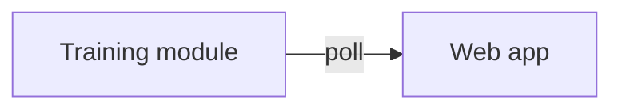

# Updating docs

These docs are Markdown files in the `docs/` directory of the web app repository, rendered by the web app at `/docs`. A change to them goes through a pull request like any code change and appears after the next deployment.

## Where docs live

Pages are grouped in numbered folders directly under `docs/`. Each folder is one group in the sidebar, and each numbered `.md` file in it is one page:

```text
docs/
  1-user-guide/
    1-getting-started.md
    2-training-datasets.md
    2-training-datasets/
      files-selected.png
  3-development/
    1-architecture.md
```

| Rule | Detail |
|---|---|
| Groups | Folders whose name starts with a number and a dash. The title comes from the rest of the name: `1-user-guide` becomes "User guide". Other folders, such as `docs/adr/`, are not shown |
| Pages | `.md` files in a group whose name starts with a number and a dash. The title is the first `#` heading |
| Order | Groups and pages by their number, compared as numbers, so `10-` comes after `9-` |
| URLs | The file name without the number and `.md`: `docs/3-development/1-architecture.md` is `/docs/architecture`. URLs do not include the group, so every file name must be unique across groups |
| `/docs` | Redirects to the first page of the first group |
| Images | In a folder named after the page, next to it |

Startup logs an error when two pages share a URL or a number, and a warning when a page in a group has no number. Markdown files directly in `docs/` are not loaded.

## Style guide

Write plainly and slightly formally. Address the reader as "you" and use the present tense; use "we" only for decisions of the team. Avoid contractions, jokes, "simply", "just" and sales words. Use the terms from `GLOSSARY.md` in the repository root, such as web app, training module, training machine and training task.

Start a page with one or two sentences on what the subject is and why it matters, without a heading. Then order the sections by what the reader wants to do. The only worked example belongs in Getting started.

| Element | Rule |
|---|---|
| Headings | One `#` heading, the page title. Sections use `##` and `###`, in sentence case, with neutral wording ("Choosing individual files", not "I know which files I want") |
| Paragraphs | At most about four sentences. Split a page that grows past about 1,000 words, except reference pages such as Configuration |
| Steps | A numbered list only when the order matters and there are more than three steps; otherwise short paragraphs |
| Tables | For settings, messages and reference, never for explanations |
| Interface words | Bold, exactly as shown on screen: **Create Training Dataset** |
| Code style | Paths, values, commands, variables and messages |
| Screenshots | At most one per task, only where words would be slower, always with alt text. Retake them when the interface changes |
| Warnings | A blockquote that starts with a bold sentence, only for lost data, leaked secrets or anything that cannot be undone |
| Troubleshooting | The last section of a page, as a table of messages and solutions |

Never write secret values, and keep personal EOS paths generic. Every page is public.

Agents that write or edit a page run the `humanizer` skill on it before committing. Human authors do not have to.

## Markdown features

The docs use GitHub Flavored Markdown: tables, strikethrough, task lists and links written as bare URLs work.

Code blocks always name their language, so they are highlighted. Any [Chroma lexer](https://github.com/alecthomas/chroma#supported-languages) name works; use `ini` for `.env` files. Write commands so they can be pasted as they are, without a `$` prompt, and write placeholders as `<machine id>`. A sentence before the block says what it does. Every code block gets a **Copy** button.

````markdown
Set the machine credentials in `.env`:

```ini
MACHINE_ID=<machine id>
```
````

Link to another page with its URL, and to a section with its anchor. Anchors are the heading in lower case, with spaces replaced by dashes, most punctuation removed and `sec-` in front: the heading "Markdown features" on this page is `#sec-markdown-features`. Write headings in plain ASCII when other pages link to them.

```markdown
See [Configuration](/docs/configuration) and [Diagrams](/docs/updating-docs#sec-diagrams).
```

Images use an absolute path under `/docs/static/`, which serves the `docs/` directory. A relative path does not work, because page URLs do not include the group folder.

```markdown

```

Raw HTML is not rendered. The web app drops it and logs a warning naming the file at startup. HTML comments are allowed and are not shown.

## Diagrams

Diagrams are [Mermaid](https://mermaid.js.org/) code blocks. The page loads Mermaid only when it contains a diagram, and draws it in the browser with the page's font and colour mode.

````markdown
The training module always starts the conversation:


````

- A diagram lives in the one page it belongs to; other pages link to that page.
- It shows what is in the code when the page is written. A pull request that changes what a diagram shows updates the diagram.
- Names follow `GLOSSARY.md`. Do not use "GUI", "Backend" or "Queue System" as component names.
- Keep a diagram to about 15 nodes, and split a larger one.
- Write at least one sentence before the diagram that says what to take from it, and set `accTitle` and `accDescr` for screen readers.
- Do not set a theme or an `%%{init}%%` block. The look comes from the page.
- Screenshots stay images; everything else is Mermaid.

The database diagram on [Data model](/docs/data-model) shows every column except `created_at`, `updated_at` and `deleted_at`.

## Checking a page

The web app reads the docs once at startup, so restart it after every change. With Docker Compose, rebuild the image, because `docs/` is not mounted into the container. [Local development](/docs/local-development) describes both setups; `make run-test` is enough for docs.

Before opening the pull request:

1. Read the page in light and dark mode, at full width and at phone width.
2. Check that every diagram is drawn and not replaced by an error message.
3. Run `make test`. It fails when a link to a page, an anchor or an image under `/docs/static/` points to nothing.
4. Check the startup log for warnings about raw HTML, missing numbers or duplicate pages.

External links are not checked automatically.
